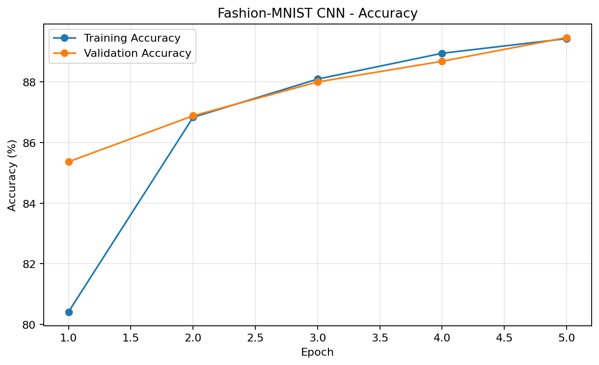
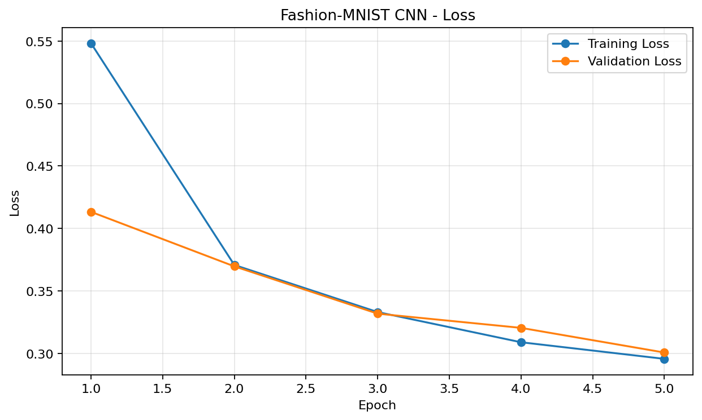
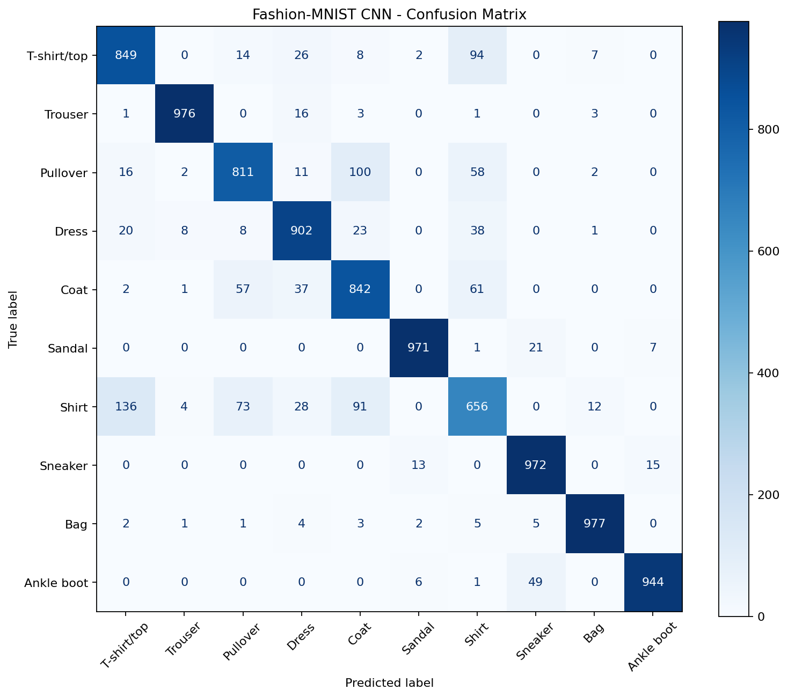
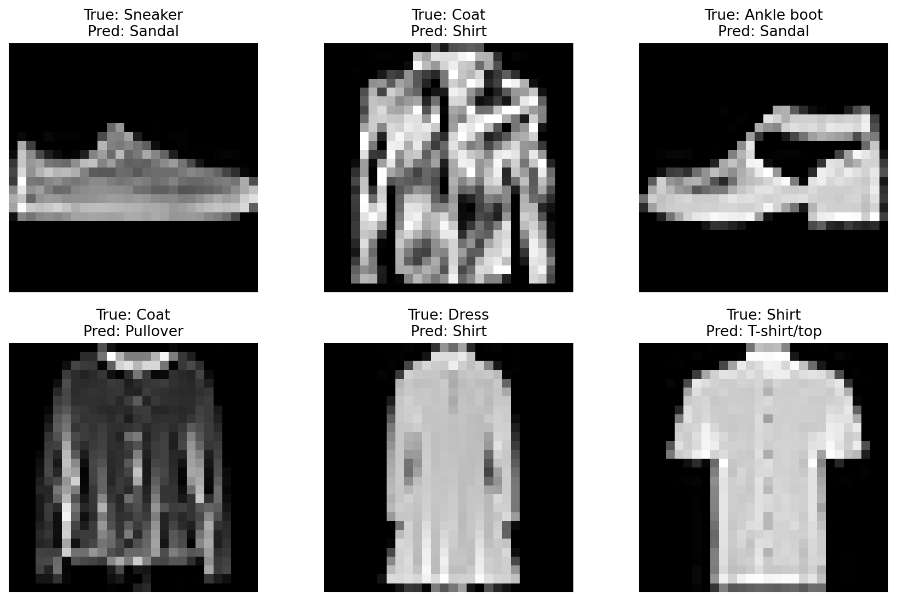
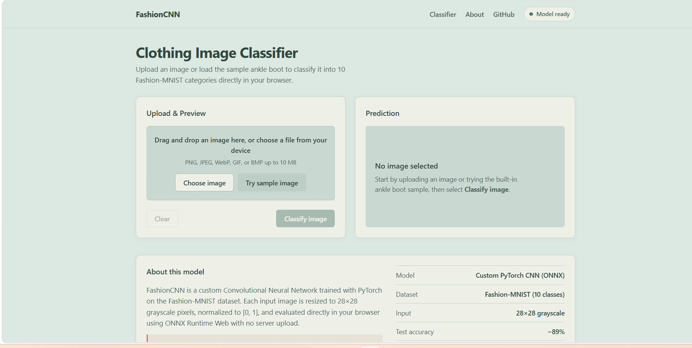

# FashionCNN — Clothing Image Classification

A small computer vision project developed as a hands-on learning exercise.

I built and trained a convolutional neural network (CNN) from scratch using PyTorch and the Fashion-MNIST dataset. After evaluating the model, I exported it to ONNX and built a simple browser interface using HTML, CSS and vanilla JavaScript.

The purpose of this project was to understand the complete machine learning workflow by implementing it myself, rather than to develop a production-ready clothing recognition system.

## Project Overview

The project consists of two parts:

**1. CNN training and evaluation**

A custom neural network trained on grayscale clothing images from Fashion-MNIST. The notebook covers data loading, training, validation, testing and error analysis.

**2. Browser-based inference**

A lightweight web interface that allows users to upload an image and run the trained CNN directly in their browser using ONNX Runtime Web.

No frontend framework or Python inference server is required.

## Dataset

The model was trained using [Fashion-MNIST](https://github.com/zalandoresearch/fashion-mnist), which contains 70,000 grayscale clothing images of size 28×28 pixels.

The dataset includes 10 classes:

| Label | Class |
| --- | --- |
| 0 | T-shirt/top |
| 1 | Trouser |
| 2 | Pullover |
| 3 | Dress |
| 4 | Coat |
| 5 | Sandal |
| 6 | Shirt |
| 7 | Sneaker |
| 8 | Bag |
| 9 | Ankle boot |

The data was divided into:

| Split | Images |
| --- | ---: |
| Training | 54,000 |
| Validation | 6,000 |
| Test | 10,000 |

The training and validation sets were created from the original training split. The official test split was kept separate for evaluation.

Images were converted to PyTorch tensors using `transforms.ToTensor()`.

## CNN Architecture

The model was implemented using `torch.nn.Module` without pretrained weights.

```text
Input                         (N, 1, 28, 28)
  |
Conv2d(1, 8, kernel_size=3, padding=1)
ReLU
MaxPool2d(2, 2)               (N, 8, 14, 14)
  |
Conv2d(8, 16, kernel_size=3, padding=1)
ReLU
MaxPool2d(2, 2)               (N, 16, 7, 7)
  |
Flatten                       (N, 784)
  |
Linear(784, 10)               (N, 10)
```

The final layer produces 10 logits, one for each clothing category.

## Training Configuration

| Parameter | Value |
| --- | --- |
| Framework | PyTorch |
| Optimizer | Adam |
| Learning rate | 0.001 |
| Loss function | CrossEntropyLoss |
| Training epochs | 5 |
| Training batch size | 32 |
| Input dimensions | 1 × 28 × 28 |

Training and validation metrics were recorded after each epoch.

The model was evaluated using accuracy, precision, recall, F1-score and a confusion matrix.

## Training Results

The CNN reached approximately **89% test accuracy** on Fashion-MNIST.

The final published test result should be taken from the saved model checkpoint. Slightly different results were observed during notebook experimentation.

### Accuracy Curve



### Loss Curve



The training and validation curves show improving performance during the five training epochs. There was no clear sign of severe overfitting in this experiment.

## Error Analysis

### Confusion Matrix



The model performed relatively well on visually distinct categories such as trousers, bags and footwear.

Clothing categories with similar shapes were more difficult to distinguish. In particular, shirts were sometimes confused with T-shirts, pullovers and coats.

### Misclassified Examples



Inspecting incorrect predictions was an important part of the exercise. It helped identify the limitations of using a small CNN on low-resolution clothing images.

## Browser Application

The trained model was exported from PyTorch to ONNX and integrated into a static web interface.

### Technologies

- HTML5
- CSS3
- Vanilla JavaScript
- ONNX Runtime Web

The browser application provides image upload, image preview, preprocessing, category prediction and a probability distribution across the 10 classes.

### Web Interface



The browser processes images by converting them to grayscale, resizing them to 28×28 pixels and normalizing pixel values to the range [0, 1].

The resulting tensor has shape:

`[1, 1, 28, 28]`

ONNX Runtime Web runs the model and the resulting logits are converted into class probabilities using softmax.

The ONNX export was also checked against PyTorch using a Fashion-MNIST sample. Both models produced the same predicted class with only a small numerical difference in the output scores.

## Run Locally

Clone the repository:

```bash
git clone https://github.com/YOUR_USERNAME/fashion-cnn.git
cd fashion-cnn
```

To run the notebook, install the Python dependencies:

```bash
pip install -r requirements.txt
```

Open `fashion_cnn.ipynb` using Jupyter Notebook or Google Colab.

To run the web application, open a terminal inside the `web` folder:

```bash
cd web
python -m http.server 8000
```

Then visit:

<http://localhost:8000>

On Windows, `py -m http.server 8000` can be used if the `python` command is unavailable.

## Project Structure

```text
fashion-cnn/
├── README.md
├── .gitignore
├── requirements.txt
├── fashion_cnn.ipynb
├── models/
│   ├── fashion_cnn.pth
│   └── fashion_cnn.onnx
├── figures/
│   ├── accuracy_curve.png
│   ├── loss_curve.png
│   ├── confusion_matrix.png
│   ├── misclassified_examples.png
│   └── web_demo.png
└── web/
    ├── index.html
    ├── style.css
    ├── scripts.js
    ├── sample_ankle_boot.png
    └── models/
        └── fashion_cnn.onnx
```

## Limitations

This project was developed for educational purposes.

The model was trained on Fashion-MNIST, which contains small, centered grayscale clothing images. Real photographs may have different backgrounds, lighting, camera angles and image compositions.

Although the CNN achieves approximately 89% accuracy on the Fashion-MNIST test set, this performance should not be expected on arbitrary real-world clothing photographs.

For example, during browser testing, a real T-shirt photograph was incorrectly classified as trousers. This illustrates the difference between the training dataset and real-world inputs, often referred to as **domain shift**.

The browser application can accept ordinary image files, but the model has not been validated for reliable classification of those photographs.

Softmax probabilities are model outputs and should not be treated as calibrated confidence estimates.

## What I Learned

This project helped me practice:

- Building a CNN from scratch with PyTorch
- Understanding tensor dimensions and convolutional layers
- Preparing datasets using DataLoader
- Implementing training and validation loops
- Using backpropagation and Adam optimization
- Evaluating models with multiple classification metrics
- Investigating incorrect predictions
- Saving and restoring trained weights
- Exporting PyTorch models to ONNX
- Running machine learning inference in the browser
- Understanding the difference between benchmark accuracy and real-world generalization

## Possible Improvements

Future experiments could include data augmentation, transfer learning, improved preprocessing and training with real-world clothing images.

These changes would require additional evaluation rather than assuming that accuracy will automatically improve.

## Reference

Xiao, H., Rasul, K., & Vollgraf, R. (2017).

*Fashion-MNIST: a Novel Image Dataset for Benchmarking Machine Learning Algorithms.*

<https://arxiv.org/abs/1708.07747>
